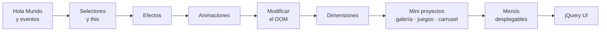

<div align="center">

# 💲 Curso jQuery: de novato a experto

**Ejercicios y mini proyectos con jQuery y jQuery UI: selectores, eventos, efectos, animaciones, manipulación del DOM, juegos, galerías, carruseles y menús.**


</div>

---

## 🎓 Certificado de finalización

<div align="center">

<a href="https://ude.my/UC-1bde53a7-c492-406b-ae92-e089ccf88105">
  
</a>

**Todo jQuery... de novato a experto**<br/>
Francisco Javier Arce Anguiano · **Udemy**<br/>
26,5 horas · Finalizado el 12 de enero de 2022

[](https://ude.my/UC-1bde53a7-c492-406b-ae92-e089ccf88105)

</div>

---

## 📖 Sobre este repositorio

Este repositorio reúne los **ejercicios y mini proyectos** que desarrollé durante el curso
**Todo jQuery... de novato a experto** de Francisco Javier Arce Anguiano en Udemy.

Cada archivo `.html` es un ejercicio independiente que se abre directamente en el navegador.
El recorrido va desde el primer `$(document).ready()` hasta componentes interactivos completos
como juegos, galerías, carruseles, menús desplegables y widgets de **jQuery UI**.

## 🗺️ Ruta de aprendizaje



## 📚 Contenido del curso

<details open>
<summary><b>1. Fundamentos, eventos y selectores</b> · <code>HolaMundo.html</code> · <code>SeleccionObjetos2.html</code></summary>

| Archivo | Temas |
|---|---|
| `HolaMundo.html` + `functions.js` | `$(document).ready()`, eventos de teclado (`keydown`, `keyup`) y de ratón (`click`, `mouseenter`, `mouseleave`), `append()` y `css()` |
| `SeleccionObjetos2.html` | Selectores por `id` y clase, `$(this)` y cambios de estilo con `css()` |

</details>

<details>
<summary><b>2. Efectos y animaciones</b> · <code>efectos.html</code> · <code>animate.html</code> · <code>AnimateCallBack.html</code></summary>

| Archivo | Temas |
|---|---|
| `efectos.html` | `show()` / `hide()`, `fadeIn()` / `fadeOut()` y `slideToggle()` |
| `animate.html` | Animaciones personalizadas con `animate()` |
| `AnimateCallBack.html` | Animaciones encadenadas, *callbacks* y `stop()` |

</details>

<details>
<summary><b>3. Manipulación del DOM y dimensiones</b> · <code>ModificarDOM.html</code> · <code>dimensiones.html</code></summary>

| Archivo | Temas |
|---|---|
| `ModificarDOM.html` | Insertar contenido con `append()`, `before()` y `after()`; eliminar con `remove()` y `empty()`; `attr()`, `addClass()` y `removeClass()` |
| `dimensiones.html` | `width()` / `height()`, `innerWidth()` / `innerHeight()` y `outerWidth()` / `outerHeight()` |

</details>

<details>
<summary><b>4. 🎮 Mini proyectos</b> · <code>galeria.html</code> · <code>juego1 .html</code> · <code>juegoArrastraImagen.html</code> · <code>carruselImagenes.html</code> · <code>rollover.html</code></summary>

| Proyecto | Descripción |
|---|---|
| **Galería de imágenes** (`galeria.html`) | Miniaturas que cambian la imagen principal con transiciones `fadeIn` / `fadeOut` / `fadeTo` y efectos al pasar el ratón |
| **Juego de memoria** (`juego1 .html`) | Cartas con parejas de números mezcladas al azar; se voltean con `on("click")` y se comparan usando atributos `data-*` |
| **Arrastra la foto** (`juegoArrastraImagen.html`) | Juego de arrastrar y soltar imágenes con `draggable()` y `droppable()` de jQuery UI |
| **Carrusel de imágenes** (`carruselImagenes.html`) | Carrusel 3D con el plugin **jQuery Roundabout** |
| **Rollover con tooltip** (`rollover.html`) | Tarjetas de videojuegos con un panel informativo animado al pasar el ratón (`hover`, `animate`) |

</details>

<details>
<summary><b>5. Menús desplegables</b> · <code>menu/</code></summary>

- Construcción de menús multinivel a partir de listas HTML anidadas (`<ul>` / `<li>`).
- Estilos propios para el menú y uso de plugins de jQuery (`jquery.dropdown.js`, `jquery.dropmenu.js`).
- Ejemplo temático: un menú sobre **mitología griega** (`menu2.html`).

</details>

<details>
<summary><b>6. jQuery UI</b> · <code>Jquery-UI/</code></summary>

| Archivo | Temas |
|---|---|
| `index.html` | Página de ejemplo con los widgets principales: acordeón, autocompletar, botones, *datepicker*, diálogos y pestañas |
| `BaseUI.html` | Clases CSS del *framework* de jQuery UI y estados `hover` |
| `iconos_personalizados.html` | Botones con iconos personalizados (`button()`) |
| `draggable_arrastrar.html` | Elementos arrastrables con `draggable()` |
| `acordeon.html` | Widget acordeón (`accordion()`) |
| `autocomplete.html` | Autocompletar en un `input` con una lista de videojuegos y búsqueda que ignora tildes |

Tema visual: **UI Lightness** (jQuery UI 1.10.4).

</details>

## 🛠️ Tecnologías

| Categoría | Herramientas |
|---|---|
| Librerías | jQuery 1.11.2 y 3.3.1, jQuery UI 1.10.4 y 1.12.1 |
| Plugins | jQuery Roundabout, Prefix Free, plugins de menú desplegable |
| Lenguajes | JavaScript, HTML5, CSS3 |

## 🚀 Cómo ejecutar los ejercicios

```bash
# 1. Clonar el repositorio
git clone https://github.com/JairoCastanedaP/CursoJquery1.git
cd CursoJquery1

# 2. Abrir cualquier ejercicio en el navegador, por ejemplo:
xdg-open galeria.html
```

Las librerías están incluidas en el repositorio, así que no hace falta instalar nada.
Solo `AnimateCallBack.html` y `dimensiones.html` cargan jQuery desde el CDN de Google y necesitan conexión a Internet.

## 📂 Estructura del repositorio

```text
CursoJquery1/
├── HolaMundo.html            # Primer ejercicio + functions.js
├── SeleccionObjetos2.html    # Selectores y $(this)
├── efectos.html              # show/hide, fade, slide
├── animate.html              # animate()
├── AnimateCallBack.html      # Callbacks y stop()
├── ModificarDOM.html         # append, before, after, remove…
├── dimensiones.html          # width, innerWidth, outerWidth…
├── galeria.html              # 🎮 Galería de imágenes
├── juego1 .html              # 🎮 Juego de memoria
├── juegoArrastraImagen.html  # 🎮 Arrastrar y soltar
├── carruselImagenes.html     # 🎮 Carrusel 3D (Roundabout)
├── rollover.html             # 🎮 Rollover con tooltip
├── menu/                     # Menús desplegables
├── Jquery-UI/                # Widgets de jQuery UI
├── imagenes/                 # Recursos gráficos
└── docs/img/                 # Certificado
```

## 👤 Autor

**Jairo Alejandro Castañeda Pedraza**

[](https://github.com/JairoCastanedaP)

---

<div align="center">

⭐ Si este repositorio te sirve como guía de estudio, ¡déjale una estrella!

</div>
